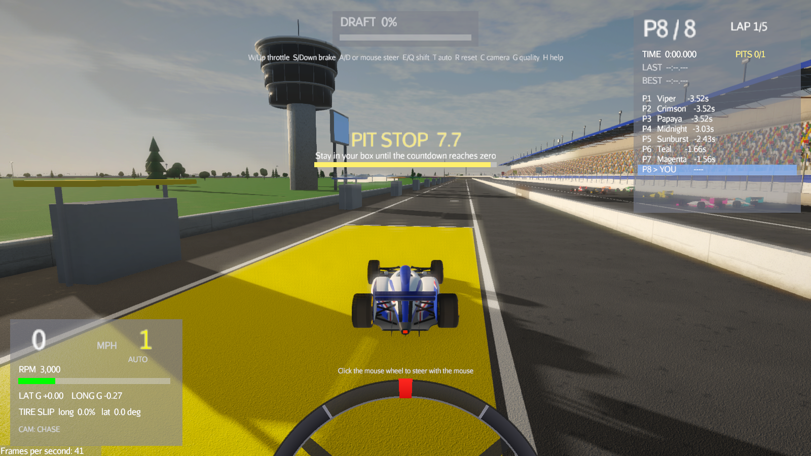
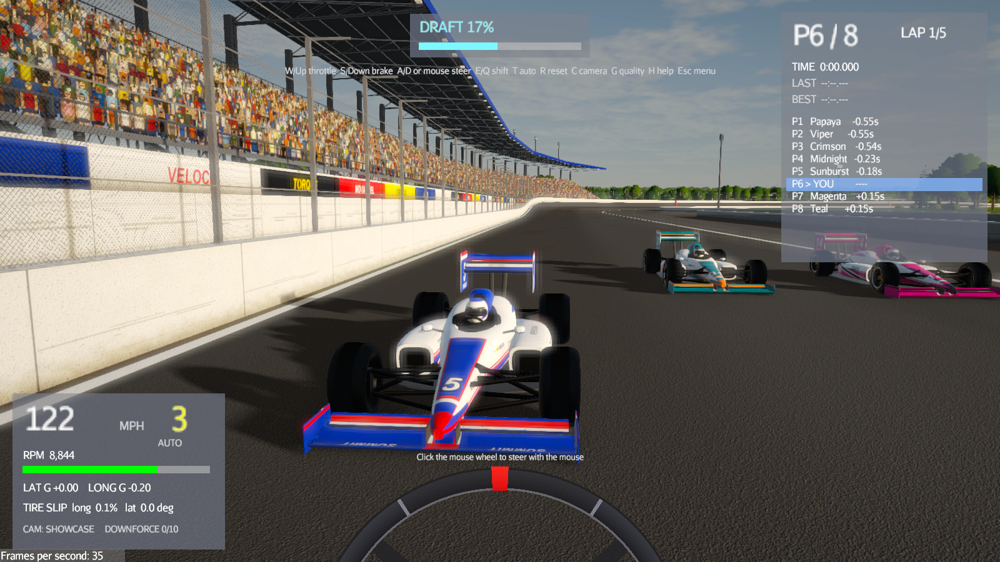

# Racing Sim (POC)

A 3D open-wheel racing proof of concept built with **jMonkeyEngine 3.9** + **Minie 9** (Bullet) on Java 21, started as a single-day build.
It has two tracks: Indy cars race a 2.5-mile banked oval with a rolling start and pit stops, and 1995-style Formula cars race a hilly 4.352-mile road course from a standing start.
It has custom tire and aero physics at a fixed 240 Hz, up to 32 AI opponents with their own race craft (rookies to veterans), and aerodynamic drafting.


A second track, the **Road** course: a 4.352-mile (7,004 m) clockwise road course traced from a circuit map, with 102.2 m of elevation (down into a valley, up a steep climb and a long straight to the summit, then down through the hairpins and sweeps to the lowest point), red and white kerbs through the turns, grass run-off and barriers, and a standing start: the field lines up two by two, staggered, and goes when five red lights go out (the race clock starts then). Race on it with `./gradlew run -Ptrack=road` (or `-Dtrack=road`); `-Ptrack=road` works for `simCheck` too. The AI drives a minimum-curvature racing line with braking points worked out from grip, downforce, the turn and the slope, and passes on the brakes, down the inside of the next turn. Every car runs more wing there (and the Indy car, raced there with `-Pcar=indy`, shorter road-course gearing, `VehicleSpec.roadFinalDrive`). The road course has no pit lane, so pit stops are oval only. It sits in wooded hills, with grandstands at the start, round the first-turn hairpin, beside the valley sweep and at the last chicane (see [Surroundings](#surroundings)). Pick it on the menu's TRACK row, or start on it with `-Ptrack=road`.

The oval is raced in a 1995-style Indy car: 780 kg, about 870 hp at speedway boost, about 235 mph flat out without a tow. Its liveries are painted textures (see [Visuals](#visuals-and-the-blender-asset-pipeline)).

The road course is raced in a 1995-style **Formula car**, modeled in Blender by `blender/make_f1_car.py` (a raised nose with the front wing hung beneath it, a tall airbox, sidepods, a two-element rear wing, 13" wheels with tall slick sidewalls): 4.42 m (14.5 ft) long, 2.90 m wheelbase, 2.00 m wide, 600 kg, about 700 hp. It reaches 215 mph flat out without a tow at minimum wing, does 0-100 mph in about 3.5 s, makes 1,000-1,500 kg of downforce at 165-200 mph, and stops from 200 mph in 118-128 m (5-5.5 g at the start of the stop) on carbon brakes. Each team has its own 1995-style scheme in several colors (split two-tone, sweeps with streaks, arrows, blocks, stripes, waves), with made-up sponsors' lettering and a helmet to match; the player's car is white and red. The paint is the `MatDefs/Livery.j3md` material: a satin base under a glossy clear coat that reflects the sky, painted from the position on the car by `MatDefs/Livery.frag` (no UVs or per-car textures; `vehicle/FormulaPaint`, the schemes in `vehicle/CarPaint`). `-PplayerPaint=N` (`-DplayerPaint=N`, 0-7 the hand-made schemes: Player, Crimson, Papaya, Viper, Midnight, Sunburst, Magenta, Teal; higher numbers the generated ones) gives the player's car another team's scheme. The Indy car keeps its baked liveries, under the same clear coat. Both cars are presets in `VehicleSpec` (`VehicleSpec.indy()`, `VehicleSpec.formula()`) with their own tires, aero, collider, brakes and gearing; `VehicleSpec.forTrack()` picks the car for the track, and `-Pcar=indy` or `-Pcar=f1` (`-Dcar=`) races either car on either track.

**[Watch the 30-second opening movie (MP4, 56 MB)](docs/opening-movie.mp4)**: splash screen, race setup, and a rolling start with sound.

**Windows download:** get `RacingSim-windows-x64.zip` from the [latest release](https://github.com/fplatten/racing-sim/releases/latest), unzip it and run `RacingSim.exe`. No Java install is needed: it is a GraalVM native executable. Keep the DLLs and the `lib` folder next to it, since Java's AWT uses them to draw the car numbers. If no sound device can be opened (none plugged in, or one Windows won't start, such as a sleeping monitor's speakers), the game runs without sound instead of stopping; `-Dracingsim.silent` turns sound off on purpose. To build it yourself, install GraalVM for JDK 21 and Visual Studio 2022 Build Tools (C++), then run `GRAALVM_HOME=<graalvm dir> native-image/build.sh`. The reflection, JNI and resource configuration in `native-image/` was recorded by GraalVM's tracing agent during a scripted run.

```
./gradlew run          # race (Windows PowerShell: .\gradlew.bat run)
./gradlew simCheck     # headless 8-car simulation with telemetry (no window)
./gradlew run -Ptrack=road        # race on the road course (simCheck takes -Ptrack=road too)
./gradlew run -Ptrack=road -PplayerPaint=3   # your Formula car in another team's paint scheme (0-7 hand-made)
./gradlew wallCheck    # fires a car into the wall 54 ways and reports how far it gets thrown
./gradlew carCheck -Pcar=f1       # 0-60 / 0-100 mph, the stop from 200 mph and the top speed (the Indy car without -Pcar)
```

The build pre-renders every car's livery and helmet (the player's car and all 32 possible opponents) with `bakeLiveries`, which runs automatically before the resources are packaged. Painting one at run time takes about 1.5 s; loading the baked PNG takes about 25 ms. If a baked texture is missing, the game paints that car itself.

## Race flow
0. **Splash screen:** while the game loads, a splash screen shows the title over a race-start render, with a loading bar and the step being loaded (sky, physics, track, grandstands or forest, cars, sounds, grid). Each step runs in its own frame so the bar moves, and a few extra frames compile the shaders before the splash fades into the menu. The subtitle names the track being built.

   
1. **Menu:** set up the race with Up/Down to pick a setting, Left/Right to change it (hold to repeat) and Enter to start. The field lined up behind the menu updates as you go.
   - **Track:** **OVAL** or **ROAD**. A different track is a different world, so changing it builds the world again behind the splash screen (track, scenery, physics and cars; a few seconds) and comes back to the menu with your other settings kept. The wing goes to the new track's default (none on the oval, 8 of 10 on the road course).
   - **Race length:** 5 or 10 laps on the oval, 3 or 5 on the road course (its laps are almost three times as long).
   - **Opponents:** 1–32, so up to a 33-car field like the Indy 500.
   - **Starting position:** from P1 (pole) to last.
   - **Pit stops:** none, or 1 to 3 mandatory stops for every car. `N/A` on the road course, which has no pit lane.
   - **Downforce:** a slider for your car's wings, from **SPEED** (minimum downforce, the default) to **CONTROL** (maximum downforce) in 10 steps. More downforce presses the car into the track for more grip in the turns and under braking, but the bigger wings add drag. At full downforce, the top speed without a tow drops from about 233 to about 213 mph. The HUD shows the setting as `DOWNFORCE n/10`. Every AI driver is a **rookie**, a **regular** or a **veteran**, and runs the wing that suits it, plus or minus one step at random each race: rookies run more wing (about 5 of 10: stable, but slower), veterans less (about 1: fast and loose). Each AI car plans its corner speeds for its wing, so some opponents are fast on the straights and others are quicker through the turns. Because of this, the AI starts a pass only if it can finish it before the next turn, and backs out of an outside pass it can't finish.
2. **Rolling start (oval):** every race starts on the front straight just off Turn 4, at about 130 mph. (On the road course it is a **standing start**: the field waits on the grid, two by two and staggered, under a panel of five red lights at the top of the screen. `STANDING START - GET READY` shows until the first one comes on; they light one a second, and when all five go out together, `GO!` and the race clock starts.)
   - **Grid:** Three abreast in rows of 3 with the pole on the inside, so 11 rows for 33 cars.
   - **Opening lap:** the AI cars hold their lanes through the green flag and Turns 1 and 2, taking the turns a little slower while three-wide. After Turn 2 the whole field races at full pace: each car merges onto the racing line once the line beside it is clear, and 20 s later every car is racing.
   - **Green flag:** the first crossing of the start/finish line starts lap 1.
3. **During the race:** the HUD shows `LAP n/N`, then `FINAL LAP`, and `PITS n/N` when stops are required (yellow until you have made them all, then green). The standings show each AI car's driver type (`ROOKIE`, `REGULAR` or `VETERAN`) and wing level (`W0` light to `W10` heavy). The checkered flag drops when a car completes N laps.
   - **Esc** pauses the race behind a prompt ([screenshot](docs/leave-race-prompt.png)): Enter abandons the race and returns to the menu, Esc carries on. In the menu, Esc asks whether to quit the game. Only Enter confirms these prompts; Space doesn't.
4. **Results:** the classification appears two seconds after you finish and updates as the rest of the field crosses the line. A `PITS` column shows each car's stops; a car that finishes without all its mandatory stops gets `PIT PENALTY` and is classified behind every car that made them. Enter goes back to the menu.

## Pit stops


- **Where:** take the pit entry lane on the apron at the exit of Turn 4, run down the fast lane and stop inside your **yellow box (17)** on the start/finish line. Only your own box counts.
- **Countdown:** as soon as the car is stopped in the box an **8-second** countdown starts, with a bar on screen. The crew holds the car on the brakes, so you can let go of the pedals.
- **Leaving early:** if the car leaves the box before the countdown reaches zero, the stop **does not count** (red message). Stop in the box again to restart the countdown.
- **Done:** at zero, `PIT STOP COMPLETE - GO GO GO!` appears ([screenshot](docs/pit-stop-complete.png)). Drive out through the pit exit lane, which rejoins the track at the exit of Turn 2.
- **AI cars** make the same stops, also 8 s each. Each car plans its stops spread evenly over the race, staggered by a lap between cars so the pit lane is not jammed. The AI drives the pit entry lane, holds 60 mph on pit road, stops in its own box and waits for traffic in the fast lane before pulling out. After the exit lane it stays low until the racing line beside it is clear. AI boxes use every other box first, so neighboring boxes are usually empty.


## Controls
| Key | Action |
|---|---|
| `W` / `Up` | Throttle |
| `S` / `Down` | Brake (hold at standstill for reverse) |
| `A` / `D`, `Left` / `Right` | Steer (speed-sensitive) |
| `E` / `Q` | Shift up / down (manual) |
| `T` | Toggle automatic gearbox (on by default) |
| `R` | Reset to the start/finish line (inside lane, clear of the racing groove) |
| Mouse wheel click | Engage / release mouse steering: move the mouse left/right to turn the wheel (the cursor is captured while engaged) |
| `C` | Toggle Chase / T-cam |
| `G` | Toggle high-quality post effects (SSAO, light shafts, bloom) |
| `H` | Toggle help line |
| `Esc` | In a race: pause and ask whether to leave (**Enter** quits the race and returns to the menu, **Esc** resumes). In the menu: ask whether to quit the game (**Enter** quits, **Esc** returns to the game). On the results screen: back to the menu. |

### Racing wheel / gamepad
Plug in a racing wheel or gamepad (before or during the game) and it works straight away, next to the keyboard. The help line at the top of the screen shows its name when it is connected.

| Control | Action |
|---|---|
| Wheel / left stick | Steer (the wheel position sets the steering directly) |
| Gas pedal / right trigger | Throttle |
| Brake pedal / left trigger | Brake (hold at standstill for reverse) |
| Right / left paddle (RB / LB) | Shift up / down |
| `X` | Toggle automatic gearbox |
| `Y` | Toggle camera |
| `Back` / `View` | Reset to the start/finish line |
| `Start` / `Menu` | Pause (same as Esc) |
| `A` / `B` | Menus and prompts: OK (Enter) / back (Esc) |
| D-pad | Menu navigation |

This is the standard layout of XInput (Xbox-compatible) wheels and of any gamepad GLFW recognizes. Other wheels (for example DirectInput wheels) are read as raw axes: axis 0 steers, axis 1 is the throttle and axis 2 the brake. To change the mapping, put a `controller.properties` file in the folder you start the game from (next to `RacingSim.exe` for the Windows download), for example:

```properties
mode=raw              # auto (default), gamepad or raw
device=G29            # use the first controller whose name contains this text
steer.axis=0
throttle.axis=2
brake.axis=3
steer.gain=1.5        # more steering for the same wheel angle
steer.invert=false
button.shiftUp=4
button.shiftDown=5
```

When a controller connects, the game logs its name, mode and current axis values, which helps you find the right axis numbers. See `RacingController` for every setting.

## Packages
| Package | Contents |
|---|---|
| `track` | `TrackSpline`: 2.5 mi rectangular oval (5/8 mi straights, 1/8 mi chutes, four 1/4 mi turns banked 9.2°) with `(s, d)` track coordinates. `TrackBuilder`: surface/apron/walls mesh + static `RigidBodyControl` collider (mass 0), checkered start/finish line, fence posts and pylons every 50 m, turn boards, PBR-textured surfaces and chain-link fence. `Scenery`: Blender props (grandstands along the whole front straight and round into the turns, the back-straight stands, timing tower, tents, light towers; `BannerTexture` paints the sponsor boards) and the woods (see [Surroundings](#surroundings)). `GroundShade`: color of the land around the track and where the woods grow. `TrackLayout`: the two tracks (oval, road course). `RoadCourseBuilder`: the road course's road, kerbs, run-off, barriers and collider; `Terrain`: the hills around it. `LapTracker`: laps, lap times, positions. |
| `physics` | `FixedStepPhysics` (240 Hz via Bullet sub-steps), `TireModel` (Pacejka Magic Formula + load sensitivity + friction ellipse), `AeroModel` (v² drag/downforce), `DraftingSystem` (60 m × ±3.5 m wake cone, draftFactor 0–0.35). |
| `vehicle` | `VehiclePhysics` (4-wheel raycast suspension, springs/dampers/ARBs, sub-stepped wheel spin, RWD powertrain, brakes), `Gearbox` (6-speed sequential, auto/manual, reverse), `VehicleSpec`, `CarModelFactory` (Blender glTF car + PBR materials), `LiveryPainter`, `HelmetPainter`, `BodyDetail`, `TireTexture`, `Livery`, `Car`. |
| `ai` | `AIDriver` (velocity-frame Pure Pursuit + curvature-tracking integral loop, oval race craft: drafting passes, driver types, side-by-side awareness; see [AI race craft](#ai-race-craft)), `RacingLine`, `SpeedProfile` (banked-corner speed limits with downforce + braking pass). |
| `app` | `Main`, `RaceApp`, `RaceDirector` (per-tick order: track projection → draft → drivers → physics → laps), `PlayerInput`, `CameraController`, `Environment` (sky, sun, light probe, post-processing), `ColorGradeFilter`. |
| `ui` | `Hud`: speed, RPM, gear, position, lap/last/best, lateral G, tire slip, standings (with each AI's driver type and wing level), **DRAFT %**. |

## Visuals and the Blender asset pipeline


All art assets are generated by Python scripts run in **Blender 5.2** (headless) and committed under
`src/main/resources`. The car is modeled on a 1990s North American open-wheel race car, and the look aims for
golden-hour sunlight.

| Script | Output |
|---|---|
| `blender/make_car.py` | `Models/Car/indycar.glb` (lofted monocoque, sidepods, airbox, airfoil wings, wishbones, driver) plus `wheel_front.glb` / `wheel_rear.glb` (lathe-turned slicks and rims); also saves `blender/indycar.blend` |
| `blender/make_f1_car.py` | the road course's Formula car: `Models/Car/f1car.glb` (raised nose, front wing hung beneath it, airbox, sidepods, two-element rear wing, diffuser, driver; paint parts `Livery`, `LiverySecondary`, `LiveryAccent`, `Helmet`) plus `f1_wheel_front.glb` / `f1_wheel_rear.glb` (13" rims, 0.30 / 0.38 m wide slicks) |
| `blender/make_props.py` | grandstand module (open aluminum bleachers on a steel frame, crowd rows, sponsor banner board, cantilever roof with purlins, floodlights; the open back lets light through), timing tower, tents, light tower |
| `blender/make_crowd.py` | `crowd_atlas.png`: four rows of seated spectators (clothes, caps, sunglasses, children, people cheering, empty seats) |
| `blender/make_foliage.py` | trees and shrubs (oak, maple, spruce, young tree, shrub) built from alpha-tested leaf cards, plus the leaf atlas, bark textures and the distant tree-line texture |
| `blender/make_textures.py` | tileable PBR textures: asphalt, painted wall, grass, chain link, carbon fiber |
| `blender/make_sky.py` | 4096×2048 equirectangular golden-hour sky (Cycles, physical sky with procedural cumulus) |
| `blender/make_decals.py` | `Textures/Car/decals_mask.png`: the Formula cars' made-up sponsor lettering, 16 names in a 1024×2048 atlas (white on black), projected onto the car by `MatDefs/Livery.frag`. Plain Python with Pillow and the Windows fonts, not Blender: `python blender/make_decals.py` |

```
blender --background --factory-startup --python blender/make_car.py
blender --background --factory-startup --python blender/make_f1_car.py
blender --background --factory-startup --python blender/make_props.py
blender --background --factory-startup --python blender/make_crowd.py
blender --background --factory-startup --python blender/make_foliage.py
blender --background --factory-startup --python blender/make_textures.py
blender --background --factory-startup --python blender/make_sky.py
```

## Surroundings
- **Woods:** about 3,500 trees and shrubs, planted by `Scenery`:
  - Outside the track, woods grow where `GroundShade.woodDensity` says: patchy from about 100 m out, thicker further away. They mix oak, maple, spruce and young trees, with shrubs along the wood edges, and a few lone trees stand on the lawns.
  - The infield is parkland: clumps of broadleaf trees with shrubs, and lone oaks.
  - Trees keep clear of the track, the buildings and the infield service roads.
  - Each tree gets a random size, rotation and one of three leaf tints. Trees are merged per 250 m cell, so woods behind the camera are culled.
- **Tree crowns:** made of leaf cards, with normals bent outwards from the crown center for soft, rounded shading. Vertex colors darken the inside and underside of each crown.
- **Horizon:** two rings of tree-line silhouette, 330 m and 560 m out (the far one slightly hazy), close off the horizon behind the 3D woods.
- **Road course:** the land is `Terrain`, a 12 m grid of wooded hills reaching 900 m past the track. It meets each barrier at the track's height, eases toward the lie of the land (the track's heights averaged over a few hundred metres), and rolling hills up to about 55 m high grow away from the track. From 300 m beyond the barriers it is colored as forest canopy seen from afar, and a level skirt of forest runs to the horizon (no tree-line rings there). `Scenery` stands everything on it:
  - grandstands opposite the paddock, round the outside of the first-turn hairpin, beside the valley sweep and at the last chicane, following the bends of the barrier;
  - the timing tower and six hospitality tents on the left of the grid;
  - about 10,500 trees, mostly spruce with oak, maple and young trees, in patches from 14 m beyond the barriers out to 330 m.
  - To keep the frame rate up, tree cells more than 1,200 m from the camera are not drawn, and only the trees within 80 m of the barriers (whose shadows fall on the track and the run-off) cast shadows: with the low sun, shadows from the whole forest halved the frame rate.
- **Ground:** a 5 m grid around the track (100 m cells out to 2 km). Its vertex colors come from `GroundShade`:
  - mown lawns with mowing stripes along the straights in the infield and out to about 140 m;
  - rougher, yellower meadow beyond;
  - darker forest floor under the woods;
  - large-scale variation everywhere, so the grass texture never visibly repeats.
- **Rubber groove:** cars lay rubber down along the racing line. That line is `RacingLine`: high on the straights, down to the apex at the middle of each turn, and back up on the exit. The asphalt is darker along it:
  - The band is about a car wide and fades out softly to clean asphalt at its edges.
  - It is darkest and narrowest through the turns, with two slightly darker wheel tracks, and wider and fainter on the straights, where cars spread out.
  - The visible road is split into 0.4 m strips for a smooth edge. The physics collider keeps the coarse road.
  - The groove darkens the asphalt color. It is also fed to the shader as ambient occlusion, which dulls the sky reflection that dominates the road at a driver's eye level.
- **Asphalt wear:** the 3 m tiling asphalt texture holds only fine stone grain. Anything bigger repeats every 3 m, and at racing speed the car covers about one tile per frame, so repeated stains would strobe into one stain that seems to stand still (the wagon-wheel effect). Broad patches and the odd small dark stain (more of them in the groove) are painted per vertex instead, from noise over the whole lap (`TrackBuilder.surfaceVariation`). No two are alike, and they pass by at the car's real speed.
  - Screenshots: [in the race](docs/rubber-groove.png), [from above the Turn 1 apex](docs/rubber-groove-apex.png), [woods along the back straight](docs/woods-back-straight.png).

How the game uses them:
- **Car paint:** each Indy car's paint, race numbers and loud die-cut stickers for fictional sponsors are drawn at runtime by `LiveryPainter`. `SponsorArt` draws the stickers: 16 brands, each with its own neon colors, heavy outlined italic lettering (straight, arched or growing letter by letter) and a cartoon mascot, with black and neon edges grown around the letters and the mascot so the sticker follows their shape (no rectangular plates). Every car has its own six-brand sponsor package, with no brand repeated on a car: the title sponsor on the sidepods, then associates on the rear wing, engine cover, endplates, nose and front wing. Title sponsors rotate through the field, so the first 16 cars all carry different sidepod and engine cover logos (a tire, flame, lightning bolt, oil or water drop, sun in shades, shark, robot or mountain). Everything is placed using the livery UV layout written by `make_car.py`. `BodyDetail` adds what every car shares: panel seams and fasteners (normal map), a panel-seam shading, and wear (road grime, rubber marbles, stone chips on the nose and front wing, soot at the back).
- **Formula car paint:** `MatDefs/Livery.frag` paints each Formula car from the position on the car (a port of the Unreal version's `Scripts/livery.hlsl`): six body patterns in three or four colors (0 split, 1 sweep, 2 arrow, 3 blocks, 4 stripes, 5 wave), sponsor lettering from the `make_decals.py` atlas on six panels (sidepods, engine cover, rear wing top and endplates, nose, front wing endplates; mirrored on the right so it reads from where it is seen, in black or white where the scheme's ink color would not show), and six helmet designs (crown and band, swept stripes, blades, swirl, chevron, halves). `CarPaint` holds the schemes: eight hand-made for the named teams, the rest generated from a set of paint colors.
- **Clear coat:** jME has no clear-coat shading model, so `Livery.j3md` is jME's `PBRLighting` with a lacquer layer added on top: its own Fresnel (4% face on, a mirror at grazing angles) and roughness (0.04), with the sun's glint and the sky's reflection from the light probe, over a satin base (roughness 0.38, the helmets 0.25) that is dimmed by what the coat reflects. The tops read brighter than the sides. The Indy car's baked liveries and helmets use it too, with `BodyDetail`'s seams and chips.
- **Helmets:** `HelmetPainter` paints each Indy car driver's helmet in the car's colors (three designs, a sponsor brow strip, the race number on the back) for the helmet shell, tinted visor and headrest built in `make_car.py`.
- **Tires:** `TireTexture` makes worn slicks: a scrubbed, grained tread with rubber pick-up near the shoulders and satin sidewalls with raised, worn lettering (albedo, normal and roughness maps).
- **Tire smoke:** `TireSmoke` puffs smoke from a tire's contact patch when it slides sideways past its grip peak (about 6 degrees of slip, thick by about 18), and from big lock-ups or wheelspin. The puffs grow, rise and fade over 1.6-3.2 s, and a sliding car leaves a billowing trail. ([screenshot](docs/tire-smoke.png)) All cars share one particle pool.
- **Rendering:** `PBRLighting` materials (the cars' paint: `Livery.j3md`, built on it), with image-based lighting from the sky via `EnvironmentProbeControl`.
- **Post-processing:** 4096 shadow maps, SSAO, light shafts, bloom, filmic tone mapping, a custom color grade (`ColorGradeFilter`) and FXAA.

Screenshot helpers (they exit when done):
- `RACINGSIM_AUTOSHOT=<dir>` saves screenshots into that folder.
- `RACINGSIM_SHOT_TIMES="6,12"` sets when to take them, in seconds.
- `RACINGSIM_SHOT_SKID=<yaw rate>` kicks your car into a sideways slide at the start (for example `1.6` rad/s), for tire smoke screenshots.
- `RACINGSIM_SHOT_CAM` picks the camera: `tcam`, `sun`, `profile` (your car close up from the left, a little ahead and above), `helmet` (the driver's helmet), or `distance,side,height` for a showcase camera framing your car from the front. `profile` and `helmet` match the Unreal version's `-ShotCam=profile|helmet`.
- `RACINGSIM_MOVIE=<file.avi>` records a scripted 30-second movie at a fixed 30 fps (MJPEG AVI with a 44.1 kHz stereo PCM sound track; the game sound is mixed offline frame by frame by `CarAudio.mixdown` and muxed in by `audio/AviAudioMuxer`, because jME's recorder captures video only): the splash and loading bar, menu changes (13 opponents, start P9, downforce 3/10), the rolling start with the AI driving your car, and a cut to the T-cam. Add `RACINGSIM_MOVIE_LAP=1` for the longer one-lap version: it runs until your car completes lap 1 (with a second T-cam cut down the back straight), then fades the picture and sound to black and shows the repository link. The recording is written to the AVI you name (about 190 MB, so AVIs are not kept in the repository). [`docs/opening-movie.mp4`](docs/opening-movie.mp4) is the same movie as H.264 / AAC (56 MB), converted with Blender's built-in FFmpeg (no ffmpeg install needed): `blender --background --factory-startup --python blender/avi_to_mp4.py` (defaults to `docs/opening-movie.avi` -> `docs/opening-movie.mp4`).
- `RACINGSIM_DOWNFORCE=<0..10>` sets the downforce slider.
- `RACINGSIM_PITS=<0..3>` sets the mandatory pit stops; `RACINGSIM_PIT_DEMO=1` has the AI drive your car into box 17 for a pit stop.
- `RACINGSIM_SHOT_MENU=1` keeps the menu on screen. Otherwise a race starts straight away, with `RACINGSIM_LAPS` laps (default 5).
- `RACINGSIM_SHOT_SWITCH=<s>` changes the track on the menu's TRACK row once, `<s>` seconds in (with `RACINGSIM_SHOT_MENU=1`, to see the world built again).
- `RACINGSIM_OPPONENTS` and `RACINGSIM_START` preset the field size and your grid slot.
- `RACINGSIM_AUTOPILOT=1` lets the AI drive your car.

## Pit lane


| Section | Where | What's there |
|---|---|---|
| **Pit entry** | Exit of Turn 4 | A painted divider on the apron separates the entry lane from the racing surface. The lane then curves in behind the end of the pit wall. |
| **Pit lane** | Inside the front straight, behind a concrete pit wall | A fast lane, then **33 pit boxes of 24 m each**, then a pit stand with a colored canopy behind each box, then the pit back wall. White speed-limit lines cross the lane at both ends. |
| **Your box** | Box 17, the middle one, centerd on the start/finish line | Painted **solid yellow**, with a yellow-canopied pit stand ([screenshot](docs/pit-box.png)). |
| **Pit exit** | Turns 1 and 2 | The pit exit is a separate paved lane on the inside of the race track. A grass median separates it from the track's narrowed apron, and it has white edge lines. At the exit of Turn 2 the median tapers away and the lane merges onto the race track ([Turn 1](docs/pit-exit-lane-turn1.png), [Turn 2](docs/pit-exit-lane-turn2.png), [merge](docs/pit-exit-lane-merge.png)). |

The pit road, exit lane and walls are part of the physics collider, so you can drive through. Grass strips such as the exit-lane median have grass grip. The off-track safety net treats the pit complex as part of the track. See [Pit stops](#pit-stops) for how stops work.

## Sound
All sound is synthesized at startup by `audio/SoundSynth`, so there are no audio files.

| Sound | How it's made | What drives it in the game |
|---|---|---|
| **V8 engine** | Two loops, recorded at 4,500 and 9,500 rpm, built from per-cylinder exhaust pulses, crank-order harmonics and combustion noise | Pitch follows the real engine rpm (the loops crossfade between 6,000 and 8,500 rpm); louder on throttle, quieter on lift-off and gear shifts |
| **Tire squeal** | Wobbling tonal squeal plus band-passed scrub noise | Slip angle or slip ratio beyond the grip peak, on asphalt only |
| **Wind** | Filtered noise | Rises with speed |
| **AI engines** | One positional engine per car | Doppler-shifted relative to your car, so they whoosh past |

`./gradlew audioDump -Pout=<dir>` writes the loops as WAV files.

## Off-track ground
Two colliders make up the ground:
- **Track collider:** the racing surface, apron and walls.
- **Ground plane:** an infinite static plane under the whole world. The wheels sense it as grass, with 55% of asphalt grip and much more rolling drag.

## Wall and car impacts
The car body is a rigid box, and on its own a rigid box hitting a triangle-mesh wall at racing speed behaves like a rubber ball: contacts on the wall's edges and seams get tilted normals, and every impact returns its energy as roll and lift. Two things keep crashes on the ground:
- **Vertical walls push sideways only.** `physics/WallContactFilter` makes every contact with a wall's side face horizontal. Without it, a 15° hit at 100 m/s threw the car up to 23 m.
- **Crash energy absorption.** `VehiclePhysics.absorbImpact` stands in for crushable bodywork, tires and suspension. When a Bullet step changes a car's velocity by an impact-sized amount (more than 0.6 m/s or 0.4 rad/s in one 1/240 s tick), the car keeps only 25% of the collision's roll and pitch kick and 20% of its upward kick. The spin, and the sideways and braking parts of the hit, stay fully physical. A car that clips the wall now spins and slides along it, but stays on its wheels.

`./gradlew wallCheck` fires a car into the outer wall 54 times: on the straight and in a banked turn, at 40, 70 and 100 m/s, at 5°, 15° and 30°, and nose first, sideways and backward. It reports how high the car is thrown and whether it flips or clears the wall. Before the fixes the worst case was a 23.6 m rise, with 5 cars over the wall and 6 upside down. After the fixes the worst case is 0.36 m, with none over the wall and none upside down.

A car that still gets over a wall lands and rolls on solid ground. If you're stuck outside the retaining walls for 3 s, upside down for 2 s, or (as a last resort) below the world, the car is put back on the track where it left it.

## AI race craft
The AI races oval style:
- **Single file on the racing line.** Passes come from the tow: on a straight a car closes right up in the draft of the car ahead (a "run"), pulls out late with the speed it built and slingshots by. A car that is simply faster may go by without a tow.
- **Only passes that fit.** A pass starts only where it can be finished before the next turn, and never beside a car that already has company, so three wide is rare. A pass that stops gaining, or is not alongside by the turn, is abandoned and the car tucks back in behind.
- **Back to the line only once clear:** never across a car it is alongside or has only just passed. Behind slower cars the AI lifts and brakes; it swerves only when braking can't prevent a hit.
- **Driver types:** each AI driver is a rookie, regular or veteran. Rookies pass only by the textbook (plenty of closing speed, done well before the turn) and back out of anything not finished by then. Veterans pull out with less, pass late on the straights and in the chutes, and go side by side through the turns.

The AI avoids hitting you in five ways:
- **Your path, not just your position:** a car blocks the AI if it overlaps the AI's current lane, the lane the AI is merging into, or where that car will be by the time the AI arrives. That last check uses the car's lateral speed, so the AI expects people to cut across.
- **Stopping distance:** the AI looks further ahead the faster it is closing, so a slow or stopped car is seen early. Its speed is capped so it can always stop behind.
- **Emergency swerve:** if a collision is less than 1.5 s away and braking can't prevent it, the AI moves to any free lane (unless that would make it three wide), even during the opening no-passing period.
- **A wider berth for you:** around the human player the AI keeps a longer gap (but stays close enough to draft you), allows more lateral room and assumes gentler braking. It pulls out to pass you from further back, and without a tow it passes you only with a clear speed advantage.
- **Safe rejoining:** a crashed AI car only rejoins where it won't drop in front of anyone.

`./gradlew simCheck -Pplayer=passive|erratic|reset|grass|pit|pitplayer|ai` runs the race headless (`-Pcars=1..33`, `-Plaps=`, `-Ppits=` mandatory stops; `-Pdownforce=0..1` wing level of the player car; `pitplayer` = an AI-driven player that also makes its stops in box 17) with a coasting player, a randomly lifting and braking player, a player who keeps pressing reset, an off-track test (`grass`: dropped on the infield grass and then launched over the wall), or an AI-driven player. It counts every AI-into-player contact and reports tire squeal. It also logs the gaps at the front, lists each AI driver's type and wing, and at the end prints the AI's race craft: pace (fastest and average best lap, top speed without a tow), time off the racing line (and why) and three wide, passes started, completed and abandoned (and why), passes by driver type, lead changes after the first 100 s, and what held the cars back. For tuning, `-PaiGrip=`, `-PaiGripSpread=`, `-PaiDownforce=`, `-PaiWingMax=`, `-PaiSling=`, `-PaiStallGain=`, `-PaiPullOut=`, `-PaiDirtyAir=`, `-PaiLookBase=`, `-PaiLookK=`, `-PaiLatGain=`, `-PaiLatDamp=`, `-PaiRunGap=`, `-PaiRunDecel=`, `-PaiRunPull=`, `-PaiRoomClose=` and `-PaiSetupGap=` override the AI's settings (see `ai/AIDriver.java`), `-PaiBrakeGrip=` sets how much of the grip the AI brakes with on the road course (see `ai/SpeedProfile.java`), `-PaiLateBrake=` and `-PaiOutbrake=` how late and from how far back it goes down the inside on the brakes to pass there, `-PaiPassLog` logs every pass as it starts and ends, `-PpowerScale=` scales every car's engine, `-PfinalDrive=` sets the final drive, `-Ptrack=road` runs the race on the road course and `-Pcar=indy|f1` races that car. They work for `./gradlew run` too (they are passed on as system properties). On the road course it also counts the passes made down the inside on the brakes.

`./gradlew carCheck` measures one car on the oval's front straight at minimum and maximum wing, driven by script (throttle fed in against wheelspin, brakes kept just short of locking): 0-60 and 0-100 mph, the stop from 200 mph (distance, peak and average g) and the top speed (full throttle from 200 and from 225 mph for 950 m). It measures the Indy car, or the Formula car with `-Pcar=f1`. The Unreal version's `-CarCheck` prints the same lines. With 12 cars over 10 laps, the AI is off the racing line about 30% of the time (mostly while passing), three wide well under 1% of the time, and the lead changes about a dozen times.

## Tuning notes
- **Road course passing:** a turn worth racing for is one the car must slow for (the speed profile under its flat-out speed), so a flat-out kink on the long straight is not one, and the inside and outside are those of the turn at the next braking zone. No pass is started inside a braking zone, except the late-braking move: a regular or a veteran 8-14 m behind with the braking zone about 1.5 s ahead and the inside free goes down the inside and brakes later, on a second speed profile that plans its braking on 0.95 of the grip instead of 0.82 (`-PaiLateBrake=`, `-PaiOutbrake=`).
- The engine makes about 870 hp at 12,000 rpm, and the 3.55 final drive keeps it in its power band (11,000–12,000 rpm) all the way round. Laps are about 41 s (~220 mph average), with a top speed of about 233 mph at minimum wing without a tow, and about 240 mph in a tow. In a close draft the drag reduction reaches 35%, which gives a big slingshot.
- While drafting, the trailing car loses up to about 14% of its front downforce, which shows up as understeer in the turns.
- Car parameters live in `VehicleSpec`, `AeroModel` and `TireModel`. Draft geometry is in `DraftingSystem`.
