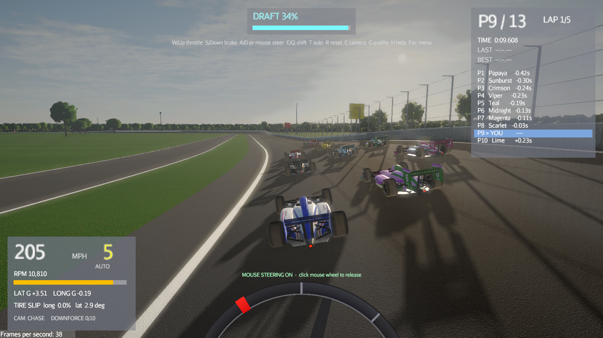
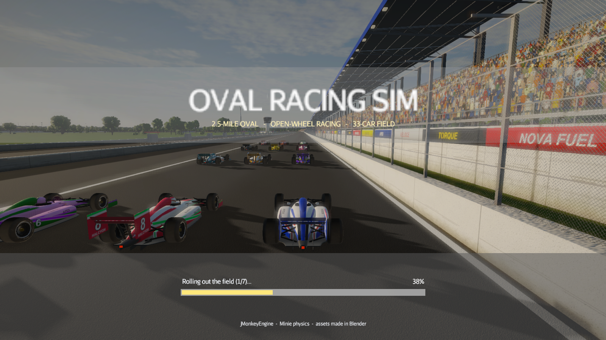
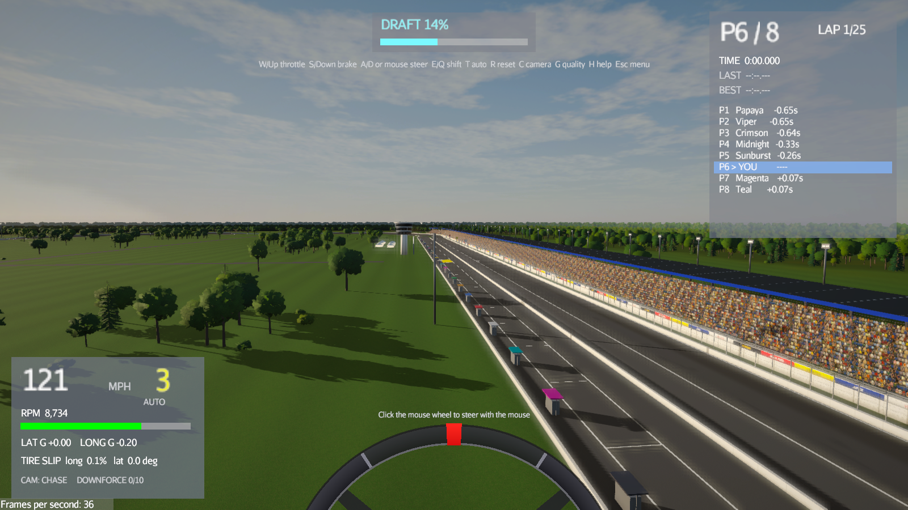

# Oval Racing Sim (POC)

Single day build of a 3D open-wheel oval racing proof of concept built with **jMonkeyEngine 3.9** + **Minie 9** (Bullet) on Java 21.
It has custom tire and aero physics at a fixed 240 Hz, up to 32 AI opponents, aerodynamic drafting and pit stops.



**[Watch the 30-second opening movie (MP4, 48 MB)](docs/opening-movie.mp4)**: splash screen, race setup, and a rolling start with sound.

**Windows download:** get `RacingSim-windows-x64.zip` from the [latest release](https://github.com/fplatten/racing-sim/releases/latest), unzip it and run `RacingSim.exe`. No Java install is needed: it is a GraalVM native executable. Keep the DLLs and the `lib` folder next to it, since Java's AWT uses them to draw the car numbers. To build it yourself, install GraalVM for JDK 21 and Visual Studio 2022 Build Tools (C++), then run `GRAALVM_HOME=<graalvm dir> native-image/build.sh`. The reflection, JNI and resource configuration in `native-image/` was recorded by GraalVM's tracing agent during a scripted run.

```
./gradlew run          # race (Windows PowerShell: .\gradlew.bat run)
./gradlew simCheck     # headless 8-car simulation with telemetry (no window)
./gradlew wallCheck    # fires a car into the wall 54 ways and reports how far it gets thrown
```

## Race flow
0. **Splash screen:** while the game loads, a splash screen shows the title over a race-start render, with a loading bar and the step being loaded (sky, physics, track, grandstands, cars, sounds, grid). Each step runs in its own frame so the bar moves, and a few extra frames compile the shaders before the splash fades into the menu.

   
1. **Menu:** set up the race with Up/Down to pick a setting, Left/Right to change it (hold to repeat) and Enter to start. The field lined up behind the menu updates as you go.
   - **Race length:** 5 or 10 laps.
   - **Opponents:** 1–32, so up to a 33-car field like the Indy 500.
   - **Starting position:** from P1 (pole) to last.
   - **Pit stops:** none, or 1 to 3 mandatory stops for every car.
   - **Downforce:** a slider for your car's wings, from **SPEED** (minimum downforce, the default) to **CONTROL** (maximum downforce) in 10 steps. More downforce presses the car into the track for more grip in the turns and under braking, but the bigger wings add drag. At full downforce, the top speed drops from about 222 to about 201 mph. The HUD shows the setting as `DOWNFORCE n/10`. Every AI car gets a random wing level (0–10) at the start of each race and plans its corner speeds for it, so some opponents are fast on the straights and others are quicker through the turns. Because of this, the AI starts a pass only if it can finish it before the next turn, and backs out of an outside pass it can't finish.
2. **Rolling start:** every race starts on the front straight just off Turn 4, at about 130 mph.
   - **Grid:** Three abreast in rows of 3 with the pole on the inside, so 11 rows for 33 cars.
   - **Opening lap:** the AI cars hold their lanes through the green flag and Turns 1 and 2, taking the turns a little slower while three-wide. On the back straight each car merges onto the racing line once the line beside it is clear.
   - **Green flag:** the first crossing of the start/finish line starts lap 1.
3. **During the race:** the HUD shows `LAP n/N`, then `FINAL LAP`, and `PITS n/N` when stops are required (yellow until you have made them all, then green). The chequered flag drops when a car completes N laps.
   - **Esc** pauses the race behind a prompt ([screenshot](docs/leave-race-prompt.png)): Enter abandons the race and returns to the menu, Esc carries on. In the menu, Esc asks whether to quit the game. Only Enter confirms these prompts; Space doesn't.
4. **Results:** the classification appears two seconds after you finish and updates as the rest of the field crosses the line. A `PITS` column shows each car's stops; a car that finishes without all its mandatory stops gets `PIT PENALTY` and is classified behind every car that made them. Enter goes back to the menu.

## Pit stops


- **Where:** take the pit entry lane on the apron at the exit of Turn 4, run down the fast lane and stop inside your **yellow box (17)** on the start/finish line. Only your own box counts.
- **Countdown:** as soon as the car is stopped in the box an **8-second** countdown starts, with a bar on screen. The crew holds the car on the brakes, so you can let go of the pedals.
- **Leaving early:** if the car leaves the box before the countdown reaches zero, the stop **does not count** (red message). Stop in the box again to restart the countdown.
- **Done:** at zero, `PIT STOP COMPLETE - GO GO GO!` appears ([screenshot](docs/pit-stop-complete.png)). Drive out through the pit exit lane, which rejoins the track at the exit of Turn 2.
- **AI cars** make the same stops, also 8 s each. Each car plans its stops spread evenly over the race, staggered by a lap between cars so the pit lane is not jammed. The AI drives the pit entry lane, holds 60 mph on pit road, stops in its own box and waits for traffic in the fast lane before pulling out. After the exit lane it stays low until the racing line beside it is clear. AI boxes use every other box first, so neighbouring boxes are usually empty.


## Controls
| Key | Action |
|---|---|
| `W` / `Up` | Throttle |
| `S` / `Down` | Brake (hold at standstill for reverse) |
| `A` / `D`, `Left` / `Right` | Steer (speed-sensitive) |
| `E` / `Q` | Shift up / down (manual) |
| `T` | Toggle automatic gearbox (on by default) |
| `R` | Reset to the start/finish line (inside lane, clear of the racing groove) |
| Mouse wheel click | Engage / release mouse steering: move the mouse left/right to turn the wheel (the cursor is captured while engaged) |
| `C` | Toggle Chase / T-cam |
| `G` | Toggle high-quality post effects (SSAO, light shafts, bloom) |
| `H` | Toggle help line |
| `Esc` | In a race: pause and ask whether to leave (**Enter** quits the race and returns to the menu, **Esc** resumes). In the menu: ask whether to quit the game (**Enter** quits, **Esc** returns to the game). On the results screen: back to the menu. |

## Packages
| Package | Contents |
|---|---|
| `track` | `TrackSpline`: 2.5 mi rectangular oval (5/8 mi straights, 1/8 mi chutes, four 1/4 mi turns banked 9.2°) with `(s, d)` track coordinates. `TrackBuilder`: surface/apron/walls mesh + static `RigidBodyControl` collider (mass 0), chequered start/finish line, fence posts and pylons every 50 m, turn boards, PBR-textured surfaces and chain-link fence. `Scenery`: Blender props (grandstands along the whole front straight and round into the turns, the back-straight stands, timing tower, tents, light towers; `BannerTexture` paints the sponsor boards) and the woods (see [Surroundings](#surroundings)). `GroundShade`: colour of the land around the track and where the woods grow. `LapTracker`: laps, lap times, positions. |
| `physics` | `FixedStepPhysics` (240 Hz via Bullet sub-steps), `TireModel` (Pacejka Magic Formula + load sensitivity + friction ellipse), `AeroModel` (v² drag/downforce), `DraftingSystem` (60 m × ±3.5 m wake cone, draftFactor 0–0.35). |
| `vehicle` | `VehiclePhysics` (4-wheel raycast suspension, springs/dampers/ARBs, sub-stepped wheel spin, RWD powertrain, brakes), `Gearbox` (6-speed sequential, auto/manual, reverse), `VehicleSpec`, `CarModelFactory` (Blender glTF car + PBR materials), `LiveryPainter`, `HelmetPainter`, `BodyDetail`, `TireTexture`, `Livery`, `Car`. |
| `ai` | `AIDriver` (velocity-frame Pure Pursuit + curvature-tracking integral loop, overtaking and side-by-side awareness), `RacingLine`, `SpeedProfile` (banked-corner speed limits with downforce + braking pass). |
| `app` | `Main`, `RaceApp`, `RaceDirector` (per-tick order: track projection → draft → drivers → physics → laps), `PlayerInput`, `CameraController`, `Environment` (sky, sun, light probe, post-processing), `ColorGradeFilter`. |
| `ui` | `Hud`: speed, RPM, gear, position, lap/last/best, lateral G, tire slip, standings, **DRAFT %**. |

## Visuals and the Blender asset pipeline


All art assets are generated by Python scripts run in **Blender 5.2** (headless) and committed under
`src/main/resources`. The car is modelled on a 1990s North American open-wheel race car, and the look aims for
golden-hour sunlight.

| Script | Output |
|---|---|
| `blender/make_car.py` | `Models/Car/indycar.glb` (lofted monocoque, sidepods, airbox, airfoil wings, wishbones, driver) plus `wheel_front.glb` / `wheel_rear.glb` (lathe-turned slicks and rims); also saves `blender/indycar.blend` |
| `blender/make_props.py` | grandstand module (open aluminium bleachers on a steel frame, crowd rows, sponsor banner board, cantilever roof with purlins, floodlights; the open back lets light through), timing tower, tents, light tower |
| `blender/make_crowd.py` | `crowd_atlas.png`: four rows of seated spectators (clothes, caps, sunglasses, children, people cheering, empty seats) |
| `blender/make_foliage.py` | trees and shrubs (oak, maple, spruce, young tree, shrub) built from alpha-tested leaf cards, plus the leaf atlas, bark textures and the distant tree-line texture |
| `blender/make_textures.py` | tileable PBR textures: asphalt, painted wall, grass, chain link, carbon fibre |
| `blender/make_sky.py` | 4096×2048 equirectangular golden-hour sky (Cycles, physical sky with procedural cumulus) |

```
blender --background --factory-startup --python blender/make_car.py
blender --background --factory-startup --python blender/make_props.py
blender --background --factory-startup --python blender/make_crowd.py
blender --background --factory-startup --python blender/make_foliage.py
blender --background --factory-startup --python blender/make_textures.py
blender --background --factory-startup --python blender/make_sky.py
```

## Surroundings
- **Woods:** about 3,500 trees and shrubs, planted by `Scenery`:
  - Outside the track, woods grow where `GroundShade.woodDensity` says: patchy from about 100 m out, thicker further away. They mix oak, maple, spruce and young trees, with shrubs along the wood edges, and a few lone trees stand on the lawns.
  - The infield is parkland: clumps of broadleaf trees with shrubs, and lone oaks.
  - Trees keep clear of the track, the buildings and the infield service roads.
  - Each tree gets a random size, rotation and one of three leaf tints. Trees are merged per 250 m cell, so woods behind the camera are culled.
- **Tree crowns:** made of leaf cards, with normals bent outwards from the crown centre for soft, rounded shading. Vertex colours darken the inside and underside of each crown.
- **Horizon:** two rings of tree-line silhouette, 330 m and 560 m out (the far one slightly hazy), close off the horizon behind the 3D woods.
- **Ground:** a 5 m grid around the track (100 m cells out to 2 km). Its vertex colours come from `GroundShade`:
  - mown lawns with mowing stripes along the straights in the infield and out to about 140 m;
  - rougher, yellower meadow beyond;
  - darker forest floor under the woods;
  - large-scale variation everywhere, so the grass texture never visibly repeats.
- **Rubber groove:** cars lay rubber down along the racing line. That line is `RacingLine`: high on the straights, down to the apex at the middle of each turn, and back up on the exit. The asphalt is darker along it:
  - The band is about a car wide and fades out softly to clean asphalt at its edges.
  - It is darkest and narrowest through the turns, with two slightly darker wheel tracks, and wider and fainter on the straights, where cars spread out.
  - The visible road is split into 0.4 m strips for a smooth edge. The physics collider keeps the coarse road.
  - The groove darkens the asphalt colour. It is also fed to the shader as ambient occlusion, which dulls the sky reflection that dominates the road at a driver's eye level.
- **Asphalt wear:** the 3 m tiling asphalt texture holds only fine stone grain. Anything bigger repeats every 3 m, and at racing speed the car covers about one tile per frame, so repeated stains would strobe into one stain that seems to stand still (the wagon-wheel effect). Broad patches and the odd small dark stain (more of them in the groove) are painted per vertex instead, from noise over the whole lap (`TrackBuilder.surfaceVariation`). No two are alike, and they pass by at the car's real speed.
  - Screenshots: [in the race](docs/rubber-groove.png), [from above the Turn 1 apex](docs/rubber-groove-apex.png), [woods along the back straight](docs/woods-back-straight.png).

How the game uses them:
- **Car paint:** each car's paint, race numbers and loud die-cut stickers for fictional sponsors are drawn at runtime by `LiveryPainter`. `SponsorArt` draws the stickers: 16 brands, each with its own neon colours, heavy outlined italic lettering (straight, arched or growing letter by letter) and a cartoon mascot, with black and neon edges grown around the letters and the mascot so the sticker follows their shape (no rectangular plates) (a tyre, flame, lightning bolt, oil or water drop, sun in shades, shark, robot or mountain). Everything is placed using the livery UV layout written by `make_car.py`. `BodyDetail` adds what every car shares: panel seams and fasteners (normal map), a glossy clear coat that goes rough where the car is dirty, and wear (road grime, rubber marbles, stone chips on the nose and front wing, soot at the back).
- **Helmets:** `HelmetPainter` paints each driver's helmet in the car's colours (three designs, a sponsor brow strip, the race number on the back) for the helmet shell, tinted visor and headrest built in `make_car.py`.
- **Tires:** `TireTexture` makes worn slicks: a scrubbed, grained tread with rubber pick-up near the shoulders and satin sidewalls with raised, worn lettering (albedo, normal and roughness maps).
- **Rendering:** `PBRLighting` materials, with image-based lighting from the sky via `EnvironmentProbeControl`.
- **Post-processing:** 4096 shadow maps, SSAO, light shafts, bloom, filmic tone mapping, a custom colour grade (`ColorGradeFilter`) and FXAA.

Screenshot helpers (they exit when done):
- `RACINGSIM_AUTOSHOT=<dir>` saves screenshots into that folder.
- `RACINGSIM_SHOT_TIMES="6,12"` sets when to take them, in seconds.
- `RACINGSIM_SHOT_CAM` picks the camera: `tcam`, `sun`, or `distance,side,height` for a showcase camera framing your car from the front.
- `RACINGSIM_MOVIE=<file.avi>` records a scripted 30-second movie at a fixed 30 fps (MJPEG AVI with a 44.1 kHz stereo PCM sound track; the game sound is mixed offline frame by frame by `CarAudio.mixdown` and muxed in by `audio/AviAudioMuxer`, because jME's recorder captures video only): the splash and loading bar, menu changes (13 opponents, start P9, downforce 3/10), the rolling start with the AI driving your car, and a cut to the T-cam. Add `RACINGSIM_MOVIE_LAP=1` for the longer one-lap version: it runs until your car completes lap 1 (with a second T-cam cut down the back straight), then fades the picture and sound to black and shows the repository link. The recording is written to the AVI you name (about 174 MB, so AVIs are not kept in the repository). [`docs/opening-movie.mp4`](docs/opening-movie.mp4) is the same movie as H.264 / AAC (48 MB), converted with Blender's built-in FFmpeg (no ffmpeg install needed): `blender --background --factory-startup --python blender/avi_to_mp4.py` (defaults to `docs/opening-movie.avi` -> `docs/opening-movie.mp4`).
- `RACINGSIM_DOWNFORCE=<0..10>` sets the downforce slider.
- `RACINGSIM_PITS=<0..3>` sets the mandatory pit stops; `RACINGSIM_PIT_DEMO=1` has the AI drive your car into box 17 for a pit stop.
- `RACINGSIM_SHOT_MENU=1` keeps the menu on screen. Otherwise a race starts straight away, with `RACINGSIM_LAPS` laps (default 5).
- `RACINGSIM_OPPONENTS` and `RACINGSIM_START` preset the field size and your grid slot.
- `RACINGSIM_AUTOPILOT=1` lets the AI drive your car.

## Pit lane



| Section | Where | What's there |
|---|---|---|
| **Pit entry** | Exit of Turn 4 | A painted divider on the apron separates the entry lane from the racing surface. The lane then curves in behind the end of the pit wall. |
| **Pit lane** | Inside the front straight, behind a concrete pit wall | A fast lane, then **33 pit boxes of 24 m each**, then a pit stand with a coloured canopy behind each box, then the pit back wall. White speed-limit lines cross the lane at both ends. |
| **Your box** | Box 17, the middle one, centred on the start/finish line | Painted **solid yellow**, with a yellow-canopied pit stand ([screenshot](docs/pit-box.png)). |
| **Pit exit** | Turns 1 and 2 | The pit exit is a separate paved lane on the inside of the race track. A grass median separates it from the track's narrowed apron, and it has white edge lines. At the exit of Turn 2 the median tapers away and the lane merges onto the race track ([Turn 1](docs/pit-exit-lane-turn1.png), [Turn 2](docs/pit-exit-lane-turn2.png), [merge](docs/pit-exit-lane-merge.png)). |

The pit road, exit lane and walls are part of the physics collider, so you can drive through. Grass strips such as the exit-lane median have grass grip. The off-track safety net treats the pit complex as part of the track. See [Pit stops](#pit-stops) for how stops work.

## Sound
All sound is synthesized at startup by `audio/SoundSynth`, so there are no audio files.

| Sound | How it's made | What drives it in the game |
|---|---|---|
| **V8 engine** | Two loops, recorded at 4,500 and 9,500 rpm, built from per-cylinder exhaust pulses, crank-order harmonics and combustion noise | Pitch follows the real engine rpm (the loops crossfade between 6,000 and 8,500 rpm); louder on throttle, quieter on lift-off and gear shifts |
| **Tire squeal** | Wobbling tonal squeal plus band-passed scrub noise | Slip angle or slip ratio beyond the grip peak, on tarmac only |
| **Wind** | Filtered noise | Rises with speed |
| **AI engines** | One positional engine per car | Doppler-shifted relative to your car, so they whoosh past |

`./gradlew audioDump -Pout=<dir>` writes the loops as WAV files.

## Off-track ground
Two colliders make up the ground:
- **Track collider:** the racing surface, apron and walls.
- **Ground plane:** an infinite static plane under the whole world. The wheels sense it as grass, with 55% of tarmac grip and much more rolling drag.

## Wall and car impacts
The car body is a rigid box, and on its own a rigid box hitting a triangle-mesh wall at racing speed behaves like a rubber ball: contacts on the wall's edges and seams get tilted normals, and every impact returns its energy as roll and lift. Two things keep crashes on the ground:
- **Vertical walls push sideways only.** `physics/WallContactFilter` makes every contact with a wall's side face horizontal. Without it, a 15° hit at 100 m/s threw the car up to 23 m.
- **Crash energy absorption.** `VehiclePhysics.absorbImpact` stands in for crushable bodywork, tires and suspension. When a Bullet step changes a car's velocity by an impact-sized amount (more than 0.6 m/s or 0.4 rad/s in one 1/240 s tick), the car keeps only 25% of the collision's roll and pitch kick and 20% of its upward kick. The spin, and the sideways and braking parts of the hit, stay fully physical. A car that clips the wall now spins and slides along it, but stays on its wheels.

`./gradlew wallCheck` fires a car into the outer wall 54 times: on the straight and in a banked turn, at 40, 70 and 100 m/s, at 5°, 15° and 30°, and nose first, sideways and backwards. It reports how high the car is thrown and whether it flips or clears the wall. Before the fixes the worst case was a 23.6 m rise, with 5 cars over the wall and 6 upside down. After the fixes the worst case is 0.36 m, with none over the wall and none upside down.

A car that still gets over a wall lands and rolls on solid ground. If you're stuck outside the retaining walls for 3 s, upside down for 2 s, or (as a last resort) below the world, the car is put back on the track where it left it.

## AI racecraft around the player
The AI avoids hitting you in five ways:
- **Your path, not just your position:** a car blocks the AI if it overlaps the AI's current lane, the lane the AI is merging into, or where that car will be by the time the AI arrives. That last check uses the car's lateral speed, so the AI expects people to cut across.
- **Stopping distance:** the AI looks further ahead the faster it is closing, so a slow or stopped car is seen early. Its speed is capped so it can always stop behind.
- **Emergency swerve:** if a collision is less than 2.5 s away, the AI moves to any free lane, even during the opening no-passing period.
- **A wider berth for you:** around the human player the AI keeps a longer gap, allows more lateral room and assumes gentler braking. It won't dive past you just because it's in your draft.
- **Safe rejoining:** a crashed AI car only rejoins where it won't drop in front of anyone.

`./gradlew simCheck -Pplayer=passive|erratic|reset|grass|pit|pitplayer|ai` runs the race headless (`-Pcars=1..33`, `-Plaps=`, `-Ppits=` mandatory stops; `-Pdownforce=0..1` wing level of the player car; `pitplayer` = an AI-driven player that also makes its stops in box 17) with a coasting player, a randomly lifting and braking player, a player who keeps pressing reset, an off-track test (`grass`: dropped on the infield grass and then launched over the wall), or an AI-driven player. It counts every AI-into-player contact and reports tire squeal.

## Tuning notes
- Clean-air laps are about 43 s (~210 mph average), with a top speed of about 222–227 mph. In a close draft the drag reduction reaches 35%, which gives a big slingshot.
- While drafting, the trailing car loses up to about 14% of its front downforce, which shows up as understeer in the turns.
- Car parameters live in `VehicleSpec`, `AeroModel` and `TireModel`. Draft geometry is in `DraftingSystem`.
